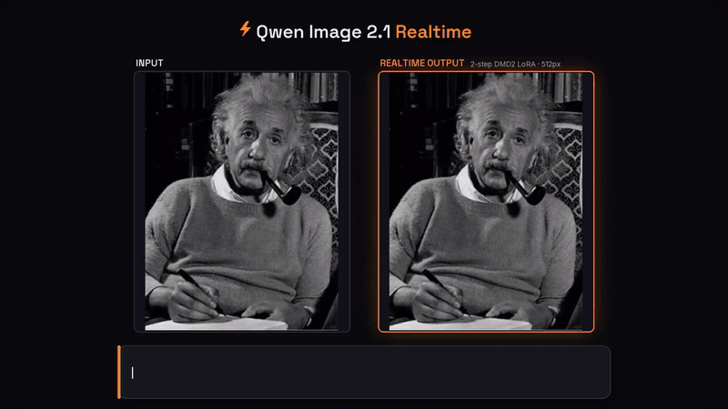

# Realtime Diffusion

Real-time, instruction-based editing of a live camera feed with few-step diffusion models.
Type an edit like "Turn the person into a marble statue" and watch it applied to your webcam in real time.

Based on and inspired by [StreamDiffusion](https://github.com/cumulo-autumn/streamdiffusion) and
[StreamDiffusionV2](https://github.com/chenfengxu714/StreamDiffusionV2).

**Models**
- **Qwen-Image 2.1** (`StreamQwen`) with our [2-step DMD2 LoRA](https://huggingface.co/linoyts/Qwen-Image-2.1-DMD2-2steps) - ~9.5 FPS edit / ~10 FPS img2img at 512px on one H100.

[](assets/demo.mp4)

## Two ways to try it

| | Hosted demo on Spaces | Live camera web demo (this repo) |
|---|---|---|
| Where | [Qwen Image 2.1 Realtime](https://huggingface.co/spaces/linoyts/qwen-image-2-1-realtime), ZeroGPU | Your own GPU, `python live.py` |
| Input | Text prompt, optional uploaded image | Your webcam feed |
| Output | Text-to-image or an edit, refreshed as you type | Every camera frame edited, streamed back |
| Setup | None, runs in the browser | Install, ~4 min warmup (compilation) |

Both use the same [2-step DMD2 LoRA](https://huggingface.co/linoyts/Qwen-Image-2.1-DMD2-2steps). The Space is the
quickest way to see the model; the web demo is the real-time streaming pipeline in this repo.

## How it works

```
camera frame -> tiny VAE -> prefill [instruction + frame] -> few denoising steps -> tiny VAE -> browser
```

- **Edit mode (default):** each frame is the condition image of an edit instruction. Pose and motion follow the
  camera; the instruction decides the look.
- **img2img mode:** the classic StreamDiffusion recipe (noise the frame, denoise 2-4 steps). Faster, but follows the
  prompt less closely.

### What makes it fast

Each technique is a few lines in one place, and most are a flag, so they can be measured one at a time.

| technique | what it does | where |
|---|---|---|
| Few-step LoRA | Our [2-step DMD2 LoRA](https://huggingface.co/linoyts/Qwen-Image-2.1-DMD2-2steps) (V1.5) at its training sigmas `[1.0, 0.5]` | `LORAS` in `stream.py` |
| Fused LoRA | LoRA merged into the weights once, so no extra matmuls per layer | `lora.py` |
| Tiny VAE | [TAEQI2.1](https://huggingface.co/madebyollin/taeqi2_1) encodes and decodes in ~2 ms each; the full VAE is never loaded | `tiny_vae.py` |
| Prompt encoded once | The 8B text encoder runs only when the prompt changes, on CPU by default | `StreamQwen.set_prompt` |
| Cached prefix K/V | The instruction (and condition frame) K/V are computed once, per prompt in img2img and per frame in edit; each step then runs only the target tokens | `CachedDenoiser` in `fast.py` |
| Static layout | Masks, rotary tables and token indices are built once per prompt, not on every call | `CachedDenoiser.set_layout` |
| Fused projections | One GEMM for Q/K/V and one for the MLP gate/up | `fuse_projections` |
| Fast attention | cuDNN attention, with the masked prefill split so the image rows run unmasked; SageAttention for RTX 4090 | `--attention` |
| FP8 | FP8 weights and activations via torchao (Ada, Hopper, Blackwell) | `--fp8 row` |
| torch.compile + CUDA graphs | The whole step and prefill compiled once for the stream | `--compile` |
| Fixed noise | One noise sample for the whole stream, so a still scene stays still | `StreamQwen` |
| Similarity filter | Skips near-identical frames (StreamDiffusion's stochastic similarity filter) | `SimilarityFilter` |

Other few-step LoRAs can be swapped in with `lora=`: the
[Pruna 6-step LoRAs](https://huggingface.co/PrunaAI/P-Q-Image-2.1) (v0.2, plain and upsampled), the
[Viggle turbo LoRA](https://huggingface.co/Viggle/Qwen-Image-2.1-viggle-turbo) and the
[lightx2v 4-step LoRA](https://huggingface.co/lightx2v/Qwen-Image-2.1-Lightning). To add one, add an entry to `LORAS`.

## Performance

Qwen-Image 2.1, one H100 PCIe, 512px, compiled, FP8:

| mode | GPU ms per frame | FPS |
|---|---|---|
| edit, 2 steps (default) | 105 | ~9.5 |
| edit, 3 steps | 131 | ~7.6 |
| img2img, 3 steps | 91-97 | ~10 |

Other GPUs are not measured yet. The design targets a 24 GB RTX 4090 (text encoder on CPU, ~14 GB on the GPU) and the
RTX Pro 6000 (96 GB) used by ZeroGPU Spaces.

## Install

Needs a CUDA GPU and Python 3.10+.

```bash
git clone https://github.com/linoytsaban/realtime-diffusion && cd realtime-diffusion
pip install -r requirements.txt
```

Weights download from the Hugging Face Hub on first run.

## Live camera web demo

```bash
python live.py --fp8 row --compile --text-encoder-device cuda
```

Warmup takes ~4 minutes (compilation). It then prints a URL with an access token; open it in Chrome and allow the
camera. Use the **Shuffle prompt** button for ready-made edits, or type your own instruction.

- `--text-encoder-device cuda` makes prompt changes near-instant but needs ~17 GB more GPU memory; leave it out on a
  24 GB card.
- Camera access needs https or localhost. Either forward the port (`ssh -L 8765:127.0.0.1:8765 <server>`) or put a
  tunnel in front:
  `touch empty.yml && cloudflared tunnel --config empty.yml --url http://127.0.0.1:8765`
  (the empty config avoids inheriting a system `config.yml`).
- One viewer at a time; a new tab takes over.

## Python API

```python
from qwen_stream import StreamQwen

stream = StreamQwen(512, 512, fp8="row", compile=True)          # edit mode, 2-step DMD2 LoRA, 2 steps
stream.set_prompt("Turn the person into a marble statue in a museum.", reference=first_frame)
out = stream(frame)  # (H, W, 3) uint8 CUDA tensor in and out
```

For img2img, pass `schedule="img2img-medium"` and call `set_prompt(description)` without a reference.

| option | values |
|---|---|
| `lora` | `"dmd2-2step"` (default), `"pruna-6"`, `"pruna-6-upsampled"`, `"viggle"`, `"lightx2v"` (see `LORAS`) |
| `schedule` | `"edit-2"` (default), `"edit-3"`, `"edit-4"`, `"edit-6"`, `"img2img-subtle"`, `"img2img-medium"`, `"img2img-strong"` |
| `fp8` | `None`, `"row"`, `"tensor"` |
| `attention` | `"cudnn"` (default), `"flash"`, `"sage"` (aimed at RTX 4090; needs `sageattention`) |
| `text_encoder_device` | `"cpu"` (default), `"cuda"` |

## Benchmark

```bash
python bench.py --video in.mp4 --compile --fp8 row [--max-memory-gb 24] --out out.mp4
```

Prints per-stage latency and writes an input | output comparison video. `--img2img`, `--lora`, `--schedule` and
`--attention` select the same options as above.

## Limitations

- Fixed noise keeps a still scene still, but its patterns stay fixed in screen space.
- Few-step LoRAs trained at a different resolution than they run at are outside their training setup.
- Prompt changes take ~5 s with the text encoder on CPU.

## License

Code: [Apache-2.0](LICENSE). Models have their own licenses: Qwen-Image 2.1, our 2-step LoRA and the Viggle and
Pruna LoRAs are under the Qwen Research License (non-commercial); TAEQI2.1 is MIT.
